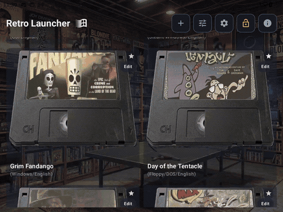

# Retro Launcher

An Android Home launcher for retro and PC game libraries, with controller navigation,
platform galleries, nostalgic cartridge/case templates, ROM scanning, and Android game shortcuts.

## Device demo

**[Watch or download the full demo](https://github.com/yakirari/retro-launcher/raw/refs/heads/main/vids/retro-launcher-demo.mp4)**
· [Gallery screenshots](vids/gallery-screenshots.jpg)

Recorded on an RG477M: approximately 39 seconds, 1280×960, 30 fps, no audio. Shows gallery
browsing and a game-launch handoff into a separately installed PC hub, not completed gameplay
or a performance benchmark. The animated preview is shortened and played at 2× speed;
the full MP4 retains the original timing. [Media details](vids/README.md).

## Requirements

**Requirements:** Android 13 or newer. Emulators and PC game hubs are installed separately.
Retro Launcher does not include emulator engines, ROMs, BIOS files, firmware, or games.

**Install and configure your emulators before scanning.** Retro Launcher is a front end for
already-installed apps, not an emulator installer. Confirm each game runs inside its emulator
first, including any required cores, BIOS/firmware and storage permissions. A platform with no
supported installed emulator is skipped during setup; install/configure it, then scan again.

> **Licensing:** original launcher code and author-created artwork are MIT-licensed. Third-party cabinet
> references retain their source terms. Asset redistribution review is still required before
> publishing this repository or an APK. See [third-party notices](THIRD_PARTY_NOTICES.md) and the
> [release checklist](docs/RELEASING.md). Not every included asset is open source.

## Features

- Two global nostalgic presets: **Grid** and **Shelf**, each remembering its own tile count.
- Default: Grid, 2 tiles and transparent tile backgrounds; appearance stays the same across filters.
- Separate **Android Games** and **Emulators & Launchers** galleries.
- Touch/controller navigation and incremental gallery pages that extend ahead of scrolling.
- Authorized-folder ROM scans, conservative duplicate handling, and editable launch targets.
- Optional first-run setup: choose one ROM root for automatic recognized-platform import and
   later artwork lookup; cancel/retry from Options. Missing emulator/core setup is clearly marked.
- Android-managed game shortcuts from GameNative, GameHub, GameHub Lite and other publishers.
- ScummVM registered-game picker and exported configuration import.
- Cover lookup, custom artwork, global captions and release-year sorting.
- Popularity sorting based on **your successful launch count**, not a global ranking.

Integration depends on each emulator's version and public launch contract. A preset/platform
name is not a guarantee that every game will boot.

## Start here

1. Install an APK from a trusted maintainer-published release **if one is available**, or
   [build a debug APK](docs/DEVELOPMENT.md). Check [GitHub Releases](https://github.com/yakirari/retro-launcher/releases)
   for published artifacts; documentation does not imply a release already exists.
2. Install/configure the emulators or PC hubs you intend to use. Test your games in those apps;
   install required RetroArch cores inside RetroArch, not inside Retro Launcher.
3. Open Retro Launcher and choose it in Android's **default Home app** settings. Keep it as Home
   when creating game shortcuts so Android can share them with this launcher.
4. For ROM-based emulators, choose your ROM root in welcome (for example, a root containing
   `nes`, `snes`, `psp`, `switch` or `mame` folders). Confirm the installed emulator/core for each
   platform, or skip it. You can also **Skip for now** and configure the library later.
5. For **GameNative, GameHub and GameHub Lite**, open the hub's own UI and create a home-screen
   shortcut for each game, then tap **Allow** in Retro Launcher. Installing a hub alone adds its
   app tile, not its private game library. For **ScummVM**, register games inside ScummVM first,
   then use its registered-game picker, exported configuration or available game shortcuts.
6. After installing an emulator, adding ROMs, changing folders, or skipping initial setup, run
   **Options → General → Scan library / Setup**. Choose a ROM root if none is saved, then start
   the scan. Repeated scans add missing games and preserve existing library metadata.
7. Follow the [user guide](docs/USER_GUIDE.md) and [integration guide](docs/INTEGRATIONS.md).

Keep another Home launcher installed so you can switch back during testing.

## Supported emulators and hubs

These are the built-in launch presets/integrations, **not bundled emulators or a guarantee of
compatibility with every build/game**. Modified packages may need a manual launch target.

| Emulator / integration | Platforms / workflow |
| --- | --- |
| Dolphin, Dolphin MMJR2 | Nintendo GameCube and Wii |
| Eden, Eden Optimized | Nintendo Switch; separate presets using the same package/contract |
| Citra, Azahar | Nintendo 3DS |
| PPSSPP | PSP |
| DuckStation | PlayStation 1 |
| NetherSX2 / compatible AetherSX2 package | PlayStation 2 |
| Vita3K | PS Vita preset; no automatic bulk folder scanner |
| NES.emu | NES |
| Snes9x EX+ | Super Nintendo |
| Mupen64Plus AE | Nintendo 64 |
| DraStic | Nintendo DS |
| Redream, Flycast | Dreamcast |
| MD.emu | Sega Genesis/Mega Drive and related Sega system choices |
| PCE.emu | PC Engine / TurboGrafx-16 |
| Neo.emu | Neo Geo |
| GBC.emu, GBA.emu | Game Boy / Game Boy Color, and Game Boy Advance respectively |
| NGP.emu | Neo Geo Pocket / Color |
| RetroArch, RetroArch64 | Named system/core choices, including MAME 2003-Plus and FinalBurn Neo; cores must be installed separately |
| ScummVM | Registered adventure-game targets; picker/config/shortcut linking |
| GameNative, GameHub, GameHub Lite | PC game shortcuts published from the hub's own UI |

See [integration details and RetroArch core choices](docs/INTEGRATIONS.md#supported-emulator-presets)
for scope and limitations. Other installed Android apps can be added as app tiles; that does not
establish per-game emulator support.

### Scan library versus shortcut refresh

**Scan library / Setup** searches your selected ROM folder; it does not install emulators,
register games inside them, or read a hub's private database. It is not a continuous filesystem
watcher: issue another scan after adding ROMs or installing a previously missing emulator.

**Hub shortcuts** are a separate path. Create them inside GameNative/GameHub/GameHub Lite while
Retro Launcher is Home. Accessible shared shortcuts are imported on return to Home/target refresh;
if missing, use **Add → Shortcuts → Shortcut setup → Refresh** and the appropriate Import control.
Rescanning a ROM folder cannot discover hub games that have not been shared as shortcuts.

## Documentation

| Audience | Guide |
| --- | --- |
| New users | [Installation, libraries, appearance and troubleshooting](docs/USER_GUIDE.md) |
| Emulator/hub users | [ROM, ScummVM and PC shortcut workflows](docs/INTEGRATIONS.md) |
| Developers | [Build, tests, deployment and asset regeneration](docs/DEVELOPMENT.md) |
| Maintainers | [Architecture and data-safety invariants](docs/ARCHITECTURE.md) |
| Contributors | [Contribution workflow](CONTRIBUTING.md) |
| Release maintainers | [Publication and release checklist](docs/RELEASING.md) |
| First preview | [0.1.0 release notes and known limitations](docs/releases/0.1.0.md) |
| Current preview | [0.1.2 changes, installation and limitations](docs/releases/0.1.2.md) |
| Repository administrators | [Hosting, security settings and audit scope](docs/HOSTING.md) |
| Security reporters | [Security reporting policy](SECURITY.md) |
| Asset contributors | [Licensing scope and third-party notices](THIRD_PARTY_NOTICES.md) |

## Status and licensing

Experimental, version 0.1.2. Preview downloads are debug-signed testing builds, not production-signed
artifacts. The root Gradle project builds only `:app`; no emulator source tree
or engine is bundled. JVM tests cover policies/parsing/merging/artwork/paging;
real-device UI and game-launch tests remain necessary.

There is currently no dedicated in-app library backup/export feature. Uninstalling or clearing
storage can lose the library and folder permissions.

Original launcher code and documentation: [MIT](LICENSE). Third-party material is excluded from
that grant where separate rights apply; see [THIRD_PARTY_NOTICES.md](THIRD_PARTY_NOTICES.md).
Read [CONTRIBUTING.md](CONTRIBUTING.md) before submitting changes. Do not submit games,
account credentials, BIOS/firmware or artwork without documented distribution rights.

## Project and maintainer

- Repository: https://github.com/yakirari/retro-launcher
- Maintainer: [@yakirari](https://github.com/yakirari)
- Bugs and proposals: [Issues](https://github.com/yakirari/retro-launcher/issues)
- Vulnerabilities: follow [SECURITY.md](SECURITY.md), not public bug reports.
