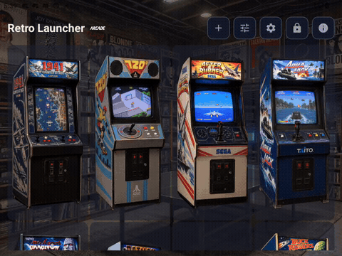

# Retro Launcher

An Android Home launcher for retro and PC game libraries, with controller navigation,
platform galleries, nostalgic cartridge/case templates, ROM scanning, and Android game shortcuts.

## Device demo


· [Media details](vids/README.md)

## Install the latest release

[Download the latest release (v0.1.5 experimental preview)](https://github.com/yakirari/retro-launcher/releases/tag/v0.1.5)
and install its APK on Android 13 or newer. If Android asks, allow installs from the app or browser
you used to download it. This preview is debug-signed, not production-signed. Emulators, ROMs,
BIOS/firmware and games are not included.

## Set up Retro Launcher

Retro Launcher is an Android **Home screen app**, not an emulator. Open Android **Settings → Apps
→ Default apps → Home app** (names vary by device) and select Retro Launcher. The Home role lets
Android share and launch game shortcuts from apps that publish them. Keep another Home app installed
so you can switch back while testing.

Install and configure your emulators first, then test games in those apps. On first run, choose your
ROM folder or skip setup and do it later. After adding ROMs or installing an emulator, run
**Options → General → Scan library / Setup**.

## Add games

- **ROM-based emulators:** organize ROMs in platform folders as shown below, choose the containing
  folder during setup, and scan. Retro Launcher only imports platforms with a supported installed
  emulator; RetroArch also needs the matching core installed and selected inside RetroArch.
- **GameNative, GameHub and GameHub Lite:** while Retro Launcher is the Home app, open the hub,
  create a home-screen shortcut for each game, and approve Android's shortcut request. Return to
  Retro Launcher; if a shortcut is missing, use **Add games → Games** or
  **Add games → Shortcuts → Shortcut setup → Refresh**. Installing a hub alone does not expose
  its private game library.
- **ScummVM:** register games inside ScummVM, then use **Add games → Games → ScummVM → Choose
  registered game**, or import an exported ScummVM configuration.

## ROM folder layout

Choose a parent folder containing one folder per platform, or choose a single platform folder:

```text
ROMs/
├── nes/
├── snes/
├── psp/
├── switch/
└── mame/
```

Put each game's ROM or disc image in the matching platform folder. Use the platform folder names
recognized by the scanner. Scanning is manual, not continuous; scan again after adding games.

## Supported emulators and hubs

These are the built-in launch presets/integrations, **not bundled emulators or a guarantee of
compatibility with every build/game**. Modified packages may need a manual launch target.

| Emulator / integration | Platforms / workflow |
| --- | --- |
| Dolphin, Dolphin MMJR2 | Nintendo GameCube and Wii |
| Eden, Eden Optimized | Nintendo Switch; separate presets using the same package/contract |
| Citra, Azahar | Nintendo 3DS |
| PPSSPP | PSP |
| DuckStation | PlayStation 1 |
| NetherSX2 / compatible AetherSX2 package | PlayStation 2 |
| Vita3K | PS Vita preset; no automatic bulk folder scanner |
| NES.emu | NES |
| Snes9x EX+ | Super Nintendo |
| Mupen64Plus AE | Nintendo 64 |
| DraStic | Nintendo DS |
| Redream, Flycast | Dreamcast |
| MD.emu | Sega Genesis/Mega Drive and related Sega system choices |
| PCE.emu | PC Engine / TurboGrafx-16 |
| Neo.emu | Neo Geo |
| GBC.emu, GBA.emu | Game Boy / Game Boy Color, and Game Boy Advance respectively |
| NGP.emu | Neo Geo Pocket / Color |
| RetroArch, RetroArch64 | Named system/core choices, including MAME 2003-Plus and FinalBurn Neo; cores must be installed separately |
| ScummVM | Registered adventure-game targets; picker/config/shortcut linking |
| GameNative, GameHub, GameHub Lite | PC game shortcuts published from the hub's own UI |

More details: [user guide](docs/USER_GUIDE.md) ·
[emulator and shortcut integration notes](docs/INTEGRATIONS.md#supported-emulator-presets).

## AI-assisted development

Some code and documentation in this project were written with AI assistance. AI-generated content
can contain errors; changes should be reviewed and tested before use.

Original launcher code is [MIT-licensed](LICENSE).
