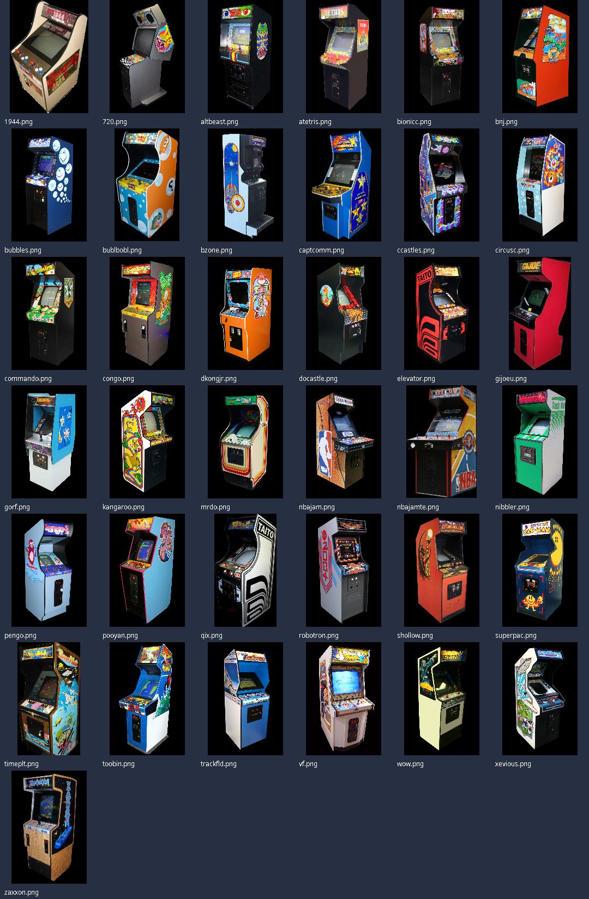
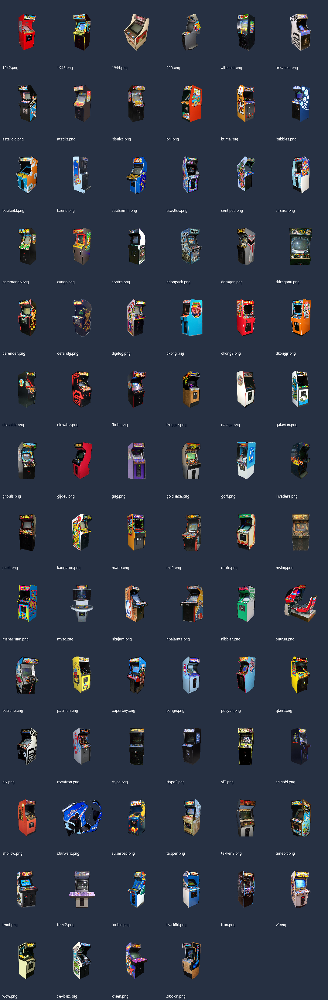

# Expanded arcade metadata and cabinet coverage — 2026-10-09

## Inventory and metadata

Inventory from a developer-owned Android device's arcade ROM directory. Actual capture has
**750 ZIP files / 383 distinct set names** after removing only a final numeric
copy marker such as ` (2)` immediately before `.zip`.

Metadata source:
https://raw.githubusercontent.com/libretro/mame2003-plus-libretro/master/metadata/mame2003-plus.xml

XML SHA-256: `9bd04ee46bb6848e29fb96bbdfef4e3399a3bf380366c32074492f056039f0e0`.

382 inventory names have exact XML records. The remaining `thndrbdj` is the
historical Japanese Thunder Blade set, explicitly a clone of `thndrbld` in:
https://raw.githubusercontent.com/libretro/mame2003-libretro/master/src/drivers/aburner.c

Its four main program ROM CRCs `a90630ef`, `9ba3ef61`, `4b95f2b4`, `2d6833e4`
and SHA-1s match modern `thndrbld1`:
https://raw.githubusercontent.com/mamedev/mame/master/src/mame/sega/segaxbd.cpp

The finite Kotlin table contains **396 games / 505 recognized ROM identities**,
including all inventory names, every former catalog identity/alias, and explicit
metadata parents. The additional identities are intentionally finite, not a
promise of support for every MAME release. There are **117 documented immediate
cloneof relationships**. Separately named games/editions retain separate catalog
identities even if old MAME marks them cloneof: After Burner versus After Burner II,
Mortal Kombat 3 versus Ultimate Mortal Kombat 3, Champion Edition versus Hyper
Fighting, and Muscle Bomber Duo versus Saturday Night Slam Masters.

Descriptions are original short factual prose, with original gameplay summaries
for 69 catalog games where confidently identified. No history paragraphs are
copied. Dates/manufacturer credits are legacy **set metadata**, not definitive
first-release chronology; source errors and uncertain years are not silently
converted into confident historical claims. Fantasy Zone 2 has uncertain year
and manufacturer in this XML. All per-set original titles, year, manufacturer,
cloneof, resolved identity, descriptions and provenance are retained in the new
arcade-metadata assets; the app does not need to parse the XML or access a network.

## Cabinet source and exact coverage

Only the specified ArcadeItalia endpoint was used:
https://adb.arcadeitalia.net/media/mame.current/cabinets/{rom}.png

Six bounded workers try the **exact set first, then explicitly recorded cloneof
parent**, then a verified rename when one is recorded. Arbitrary suffix stripping
is never used to locate artwork. Cached files, including the original 36, are
not redownloaded. Cached 404s can be refreshed explicitly. No arbitrary web image
scraping and no synthetic branding were used.

| Scope | Count |
| --- | ---: |
| Distinct device ROMs | 383 |
| Exact/confirmed-parent cabinet sources located | 284 |
| Cabinet source unavailable after finite candidates (404, no request errors) | 99 |
| Reviewed source-photo build coverage | 71 |
| Of these: exact set reference key | 63 |
| Of these: documented parent alternatives | 8 |
| Additional unchanged legacy-overlay catalog coverage | 6 |
| Total premade coverage via exact ROM / catalog identity after preparation | 77 |
| ROMs without that premade lookup coverage | 306 |
| Source-located ROMs still without a reviewed reference | 213 |

The raw download directory has 249 PNGs (~84 MiB). These are **not app assets and
not automatic build inputs**. Top-level references total 73 (36 previous + 37
new). The standalone generator produces **82 total framed cabinet assets**,
including legacy assets; 82 does not mean 82 device games have exact factory
cabinet photos. The six additional legacy mappings are arknoidu→arkanoid,
centtime→centiped, dkongo→dkong, gngt→gng, rtypeu→rtype and tmnt2po→tmnt.

Every inventory ROM and every attempted source URL/status is recorded in
[cabinet-manifest.json](cabinet-manifest.json). The concise per-ROM mapping is
[review/coverage.tsv](review/coverage.tsv). Download-source selection and
build-ready selection are distinct: an unreviewed exact download does not block
an already reviewed parent reference.

### Explicit parent alternatives (not exact variant claims)

| Device ROM | Reviewed reference | Caveat |
| --- | --- | --- |
| bubbobr1 | bublbobl | Same-game parent reference, not an exact revision cabinet claim |
| captcomu | captcomm | Regional-set parent reference; cabinet may be a conversion |
| commandu | commando | Regional-set parent reference; operator hardware unspecified |
| defendg | defender | Parent-game cabinet, not exact revision hardware |
| ffightu | ffight | Regional-set parent reference, not exact factory distribution |
| ghoulsu | ghouls | Regional-set parent reference, not exact factory distribution |
| tmnt22p | tmnt2 | Four-player parent cabinet for a two-player set; controls/layout differ |
| xmen2p | xmen | Four-player parent cabinet for a two-player set; controls/layout differ |

No differently named sequel is presented as an exact cabinet for another game.
The remaining 312 ROMs have no reviewed source-photo reference; **game snapshot
fallback is recommended**, not a falsely labeled cabinet. The manifest records
this policy. This task does not change runtime fallback/rendering logic or add
snapshots; the main integration owns that behavior. The six legacy mappings above
remain usable but are not promoted to reviewed historical-source coverage.

## New transparent silhouettes

Explicitly reviewed continuous-upright source subset:

1944, 720, altbeast, atetris, bionicc, bnj, bubbles, bublbobl, bzone, captcomm,
ccastles, circusc, commando, congo, dkongjr, docastle, elevator, gijoeu, gorf,
kangaroo, mrdo, nbajam, nbajamte, nibbler, pengo, pooyan, qix, robotron, shollow,
superpac, timeplt, toobin, trackfld, vf, wow, xevious, zaxxon.

For these sources ONLY, edge background removal is followed by restoration of
original RGB pixels between the reviewed visible outside rails in each row.
This retains dark front panels/side walls that a black-background flood could
otherwise erase. This policy must not be applied to cockpits, open frames,
cropped photos or arbitrary downloads. No branding or cabinet parts are invented;
only original image pixels and ordinary aspect-preserving resampling are used.
Prepared PNGs have true alpha backgrounds and the established 960×768 canvas;
the build generator recognizes their existing alpha silhouette and **does not
color-key them again**. Original downloads remain untouched in downloads/.

Rejected candidates remain unreviewed: aliensyn (near-black side contour),
looping/rallyx (nonzero opaque scan backdrops), kchamp (connected scan rectangle),
missile/pacland (horizontal scan-frame remnants). No claim is made that all
other downloaded photos can safely be cut with one threshold.

Per-image source/prepared SHA-256 and processing policy:
[review/cutout-manifest.json](review/cutout-manifest.json).

Compare the original source images and generated silhouettes against contrast:

Source keys identify reference collection entries, **not authenticated untouched
factory hardware**. Photos may show conversions, restoration, reproductions,
operator alterations or multigame software. Existing Pac-Man multigame-screen,
1942 conversion, Star Wars cockpit and player-layout caveats in SOURCES remain.
ArcadeItalia/progetto-SNAPS attribution and fair-use notices are **not an open
redistribution license**. Review rights before public/commercial distribution.

## Verification and reproduction

New sourcing script: scripts/source-arcade-assets.mjs (Node 18+). It consumes the
XML and actual adb inventory, generates reviewable Kotlin table/parent rows under
/tmp/arcade-generated, and publishes new provenance data with --publish-data.
--verify compares the checked-in Kotlin table and every parent pair byte-for-byte
after sorting. --download enables bounded sourcing; --refresh-missing retries
cached 404s. Metadata code changes remain a reviewed patch, not automatic source
rewrites.

New preparation script: scripts/PrepareReviewedArcadeSources.java, compiled with
NormalizeArcadeCabinets.java. It emits ONLY the listed 37 reviewed cutouts. Existing
SF2 row-interior and Shinobi threshold-16 policies remain source-specific.
Original overlay_mame images are never overwritten.

Standalone verification used JDK 17.0.14+7 and cached Kotlin 2.1.20, no Gradle:

- Kotlin catalog compiled; all 750 actual filenames, 383 ROMs, all aliases,
  descriptions, exact titles, numeric-copy handling, clone evidence, distinct
  sequels/editions, negative lookups and Turkish-locale independence passed.
- Regeneration verified 396 table rows and all 117 immediate parent pairs.
- Generator prepared 40 legacy sources and applied 73 references, yielding 82
  outputs. Cabinet verifier passed canvas geometry, all transparent borders,
  nonblank/nonrectangular silhouettes, retained black/white details, detached
  debris removal, alpha pre-cut preservation and the existing 34 owned mappings.
- Contrasting contact sheets were visually reviewed. Editor diagnostics and
  Node syntax check report no errors. No full Gradle build, APK deployment or
  device UI validation was performed; those remain main-agent integration work.